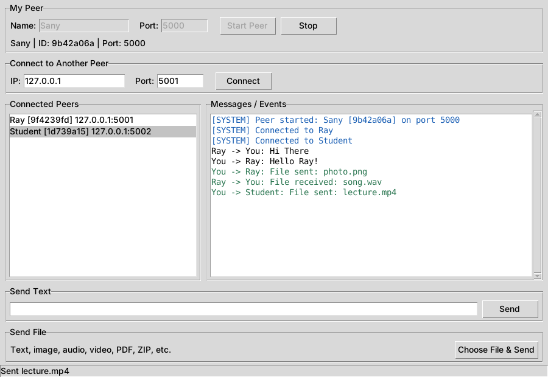
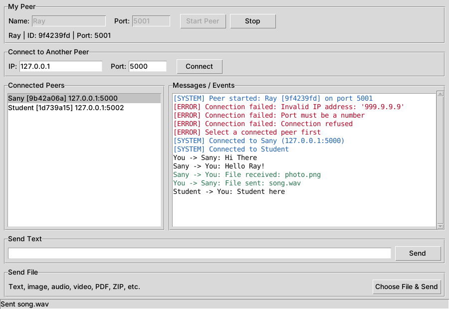
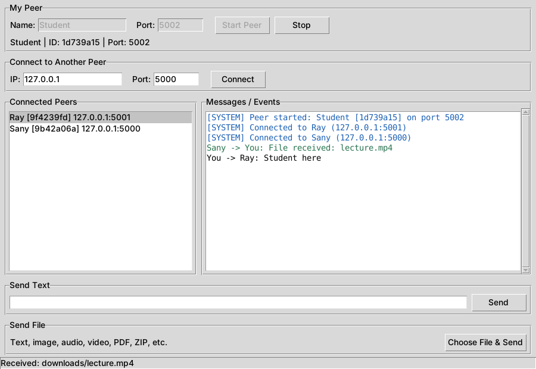

# P2P Network - Communication and File Sharing

**Course:** CSE 433 - Blockchain & Distributed Security Lab, University of Asia Pacific
**Language:** Python 3 (standard library only) | **Transport:** TCP sockets

## 1. Project description

A lightweight peer-to-peer (P2P) application. Every running copy of the program is
one **peer**, and every peer is both a **TCP server** (it accepts connections) and a
**TCP client** (it connects to other peers). There is **no central server**:
text messages and files travel directly from one peer to another.

Features:

- Start a peer with a name and a listening port
- Connect to another peer using its IP address and port (HELLO handshake)
- Show the list of connected peers
- Send text messages to a selected peer
- Send any file (text, image, audio, video, PDF, ZIP, ...) as binary data in 64 KB chunks
- Received files are saved in the `downloads/` folder
- Many peers at the same time (one thread per connection)
- Friendly error messages instead of crashes (bad IP/port, refused connection,
  peer disconnects, missing file, no peer selected, ...)

## 2. Requirements

- Python **3.9 or later**
- Windows, Linux or macOS
- Tkinter for the graphical interface (included with the standard Python installer
  on Windows and macOS; on Ubuntu/Debian run `sudo apt install python3-tk`)
- **No third-party packages** (`requirements.txt` is intentionally empty)

If Tkinter is missing, `python main.py` automatically falls back to a command-line
interface (see section 7).

## 3. Installation / setup

1. Unzip the project folder.
2. Open a terminal in the folder.
3. Check your Python version: `python --version` (use `python3` on Linux/macOS).

There is nothing to install.

## 4. How to run

```
python main.py
```

Run it once per peer (open several terminals). Each peer needs its **own port**
when several peers run on the same computer.

## 5. How to connect two peers

**On one computer (Test 1):**

1. Start **Peer A**: Name `Alice`, Port `5000`, press **Start Peer**.
2. Start **Peer B** in a second window: Name `Bob`, Port `5001`, press **Start Peer**.
3. In Bob's window under *Connect to Another Peer* enter IP `127.0.0.1`, Port `5000`
   and press **Connect**.
4. Both windows now list each other under *Connected Peers* and the log shows
   `[SYSTEM] Connected to ...`.

**On two or more computers (Test 2 / 3):**

1. Connect all computers to the same Wi-Fi/LAN.
2. On the computer that will be connected to, find its local IP address:
   Windows `ipconfig`, Linux `ip a` or `hostname -I`, macOS `ipconfig getifaddr en0`
   (for example `192.168.1.10`).
3. On the other computer enter that IP and the listening port, then press **Connect**.
4. If the connection times out, allow Python through the firewall for private
   networks (Windows Defender Firewall prompts for this the first time) or
   temporarily allow the chosen port.

A third peer can connect to any peer already in the network. To get a full
triangle (Alice, Bob and Charlie all talking directly), connect each new peer to
every existing peer.

## 6. How to send text and files

1. Click a peer in the **Connected Peers** list to select it (this is required;
   otherwise the app shows `[ERROR] Select a connected peer first`).
2. **Text:** type in the *Send Text* box and press **Send** (or Enter).
3. **File:** press **Choose File & Send** and pick any file. The status bar shows the
   progress.
4. The receiving peer saves the file in `downloads/` and logs
   `Alice -> You: File received: photo.jpg`. If a file with the same name
   already exists it is saved as `photo_1.jpg`, `photo_2.jpg`, ...

## 7. Command-line mode (optional)

```
python main.py --cli --name Alice --port 5000
```

| Command | Meaning |
|---|---|
| `peers` | list connected peers (numbered) |
| `connect <ip> <port>` | connect to another peer |
| `msg <n> <text>` | send text to peer number `n` |
| `send <n> <file path>` | send a file to peer number `n` |
| `help` / `quit` | show help / exit |

## 8. How it works

```
Peer A -> IP address + port -> TCP socket -> HELLO handshake -> application protocol -> text / file data -> Peer B
```

**Message framing.** TCP is a byte stream and does not keep message boundaries, so
every control message is sent as `[4-byte length][JSON payload]`. The receiver reads
exactly 4 bytes, then exactly that many bytes (`recv_exact()` in `protocol.py`).

**Message types**

| Type | Purpose | Example fields |
|---|---|---|
| `hello` | sent by the connecting peer to introduce itself | `peer_id`, `peer_name`, `port` |
| `hello_ack` | reply from the peer that was connected to | `peer_id`, `peer_name`, `port` |
| `text` | a text message | `sender_id`, `sender_name`, `message` |
| `file` | file metadata, followed by raw bytes | `filename`, `filesize` |
| `error` | connection refused by the other peer (for example duplicate connection) | `message` |

**File transfer.** The sender transmits the `file` metadata message and then the raw
file bytes in 64 KB chunks (the file is never loaded into memory completely).
The receiver reads **exactly `filesize` bytes**, writes them to
`downloads/<filename>.part`, and renames the file when all bytes have arrived.
A transfer that is interrupted leaves no partial file. Because the file is plain
binary data, one code path handles every file type.

**Threads.** The accept loop runs in one thread; each connection (incoming or
outgoing) has its own reader thread, so several peers can talk at the same time.
Each connection also has a send lock so a text message can never be written in the
middle of a file's bytes.

**Safety details.** Filenames received from other peers are reduced to their base
name (so `../../x` cannot escape `downloads/`), message sizes are limited, and
malformed messages disconnect only that one peer.

## 9. Project structure

```
P2P_Network/
|-- main.py          user interface (Tkinter GUI + optional command-line mode)
|-- p2p_node.py      peer networking: server, client, connections, text, files
|-- protocol.py      message framing and message builders
|-- requirements.txt (no third-party packages)
|-- README.md
|-- screenshots/     example screenshots used below
`-- downloads/       received files are stored here
```

## 10. Example screenshots

Three peers on one computer (Sany on port 5000, Ray on 5001, Student on 5002),
all connected to each other.

**Peer 1 - Sany (port 5000)**



**Peer 2 - Ray (port 5001)**



**Peer 3 - Student (port 5002)**



## 11. Troubleshooting

| Message | Likely cause |
|---|---|
| `Cannot listen on port ...: Address already in use` | another program or peer already uses that port; choose a different port |
| `Connection failed: Connection refused` | no peer is listening at that IP/port, or the port number is wrong |
| `Connection failed: Connection timed out` | wrong IP, different network, or a firewall is blocking the port |
| `Connection failed: Already connected to this peer` | you are already connected to that peer |
| `Select a connected peer first` | click a peer in the list before sending |
